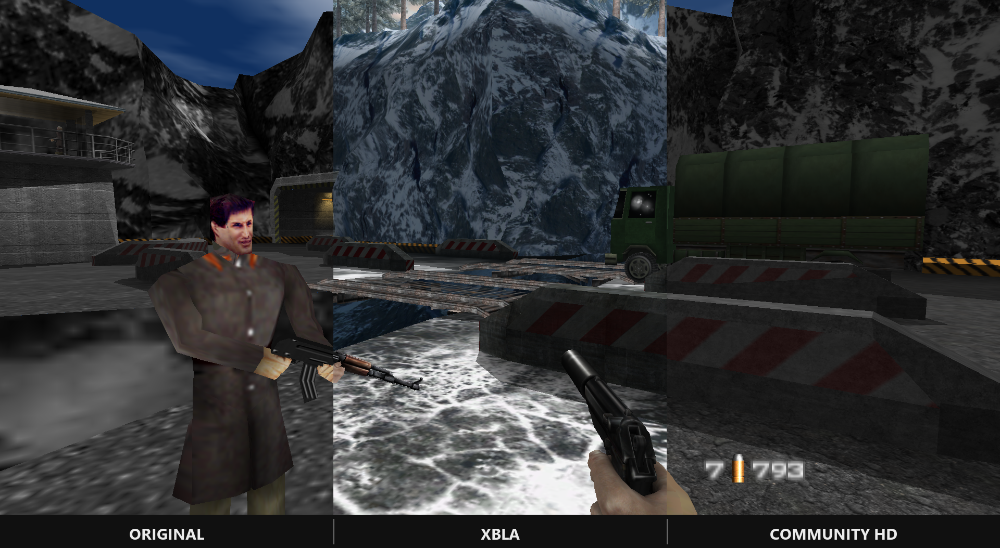
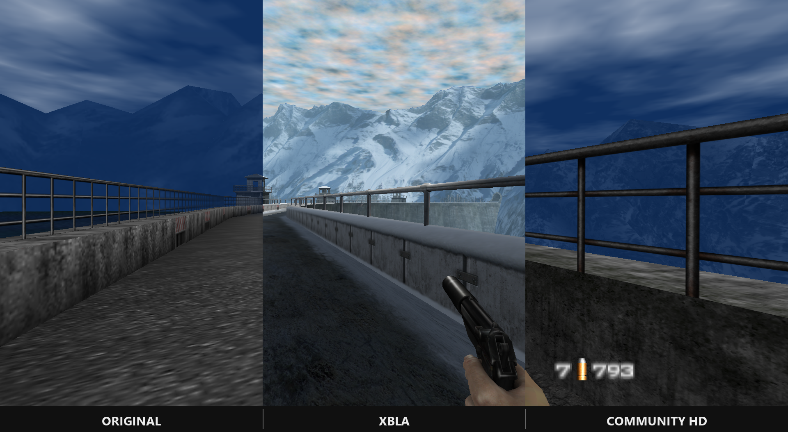
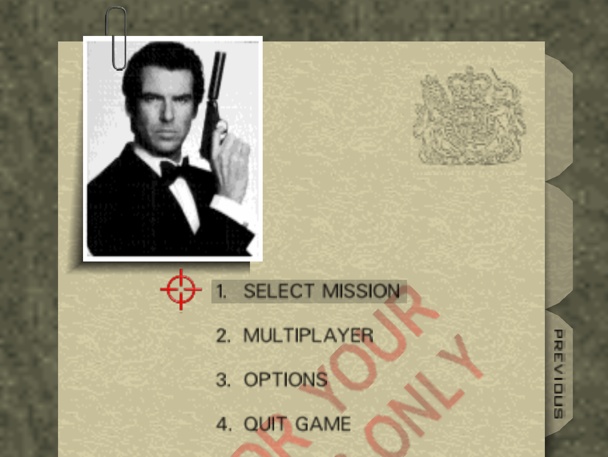
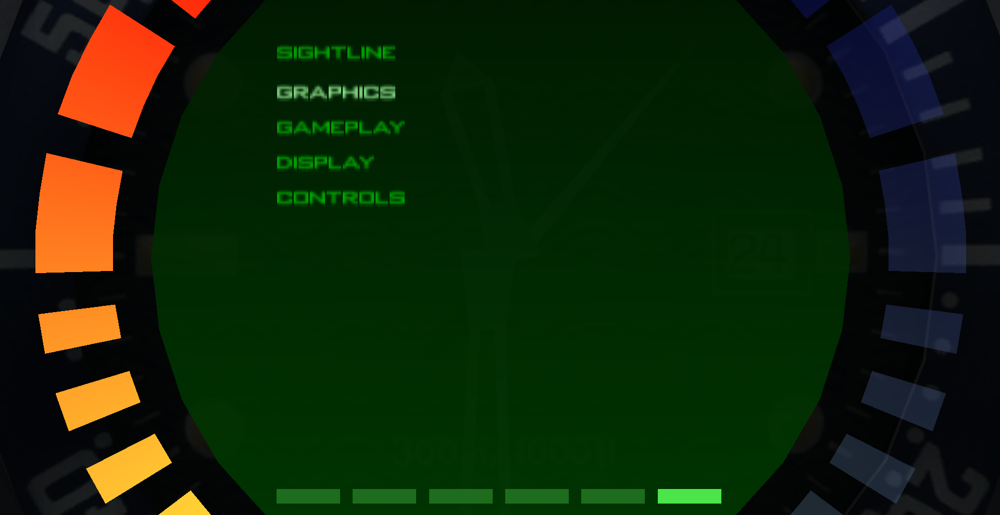
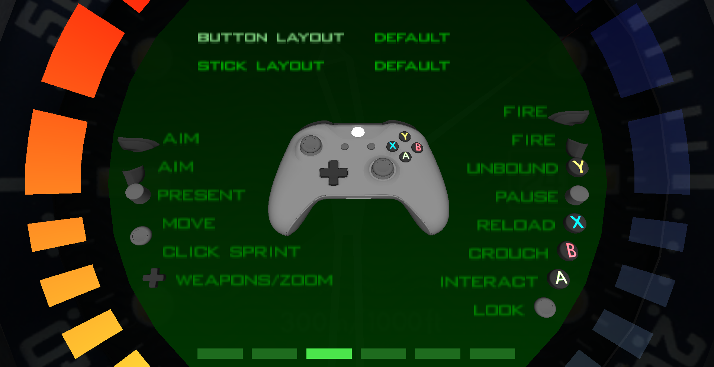

<p align="center">
  <a href="#sightline"></a>
</p>

<p align="center">
  <strong>A modernized, natively-compiled engine fork of the GoldenEye 007 N64 decompilation — the full game, no emulator.</strong>
</p>

<p align="center">
  <a href="#play-a-release-windows">Play</a> ·
  <a href="#windows-quick-start">Build</a> ·
  <a href="#presentation-original-community-hd-xbla">Presentation</a> ·
  <a href="#current-status">Status</a> ·
  <a href="docs/ROADMAP.md">Roadmap</a> ·
  <a href="https://github.com/mscrnt/Sightline/wiki">Wiki</a> ·
  <a href="https://github.com/users/mscrnt/projects/7">Project board</a> ·
  <a href="#licensing">Licensing</a>
</p>

---

## Sightline

**Sightline** is a modernized, natively-compiled engine fork of the
[GoldenEye 007 N64 decompilation](https://gitlab.com/kholdfuzion/goldeneye_src),
covering the **full game** — all campaign levels, all multiplayer maps. The
game code runs as a native Windows executable against a thin platform layer
and an OpenGL renderer; no emulator, no RCP simulation.

This repository **is** a fork of the decomp, not a wrapper around it. The
original matching build is kept permanently buildable as the correctness
oracle, and the upstream project remains the shared vocabulary for symbols,
formats, and structure. See [Credits](#credits-and-acknowledgements).

## Presentation: ORIGINAL, COMMUNITY HD, XBLA

<p align="center">
  
</p>

One setting, **PRESENTATION**, chooses how the game looks. The simulation is
the same in all three; only the picture changes.

| Presentation | What draws | Needs |
|---|---|---|
| **ORIGINAL** | the game's own N64 artwork, decoded from your ROM | nothing beyond the ROM |
| **COMMUNITY HD** | the Community HD texture pack, where it covers a texture | a prepared Community HD pack |
| **XBLA** | the XBLA remaster's textures **and** its world: backgrounds, skies and fog, characters, props and first-person weapons | a prepared XBLA pack and world assets, from your own XBLA source |

Anything a selected set lacks falls back to the game's own artwork, never to
another set. The same views cut into thirds, XBLA in the middle:

<p align="center">
  
</p>

<p align="center">
  
</p>

**Switching.** In a level, press **F5**, or **View / Create** on a
controller: the cycle goes ORIGINAL → COMMUNITY HD → XBLA and back, and the
HUD names the result. In the front end the same setting is **OPTIONS →
SETTINGS → DISPLAY → PRESENTATION**; in a level, the watch has it under
**SIGHTLINE → GRAPHICS**. All three read and write one stored value.

<p align="center">
  
</p>

**The watch.** In a level, the watch's last tab is **SIGHTLINE**: the same
native settings - GRAPHICS (world detail and presentation), GAMEPLAY,
DISPLAY and CONTROLS - without leaving the mission. Its controls tab draws
the controller you are holding, with that controller's own button labels.

<p align="center">
  
</p>

<p align="center">
  
</p>

PRESENTATION ships in **v0.3.0**. In the release package, `Get-Textures.cmd`
fetches the Community HD pack from its maintainers; the XBLA set is prepared
from a source checkout, see [docs/xbla-setup.md](docs/xbla-setup.md). The screenshots show the game's,
the Community HD project's and the remaster's artwork, which belong to their
rightsholders ([docs/images/README.md](docs/images/README.md)).

## Optimized rendering

One setting, **OPTIMIZED RENDERING**, chooses how three parts of the renderer
submit their geometry. It is **on by default**. It does not change how the game
plays: the simulation, the controls and every timer are the same in both
positions, and nothing in the simulation reads it.

Both views edit the same stored value, so they can never disagree:

- the front end, **OPTIONS → SETTINGS → DISPLAY**;
- the in-game watch, **SIGHTLINE → GRAPHICS**.

It is saved with your other settings in `%LOCALAPPDATA%\sightline\config.ini`
and survives a restart. A new install has it on; a config file written before
this setting existed reads as on.

| | What it selects |
|---|---|
| **ON** | the skydome's cloud draws submit one indexed buffer per material instead of one command per index; the background's clip positions are computed on the GPU, by a prepass whose output has been checked pixel for pixel against the original path; and the per-vertex CPU loop behind it skips the vertices no mesh of the frame reads |
| **OFF** | all three draw through the original paths, which is what every build before this setting did |

**What ON is and is not a promise of.** It is a promise about the **picture**,
and it reaches exactly as far as the comparison that was run. The **candidate
executable** — a candidate until the final commit and release, not a shipped
build — has now been compared through the setting itself rather than through a
developer switch: six clean starts, three scenes (Runway, Frigate, Facility),
the stored setting off for one start and on for the next, and all nine
frame-matched moments came back **byte-identical** at 640×480. **That is the
promise, and its scope is those three viewpoints at that resolution**: other
scenes and other resolutions have not been compared through this setting at
all, so the picture there is untested rather than guaranteed.
Earlier captures at 1920×1080 found the same renderer path byte-identical too,
but those selected it with developer switches on an earlier candidate build, so
they are evidence about that path and that build, not about this setting at that
resolution. It is **not** a promise about frame rate. Turning it on is not a
guarantee that any scene reaches any particular frame rate, and the frame times
that have been measured for it are a relative comparison between the two
positions rather than a speed claim.

**What OFF does not change.** The processor-side work accepted earlier in this
sprint is compiled in and runs either way — the background vertex helper, the
fill-query workers, the cached renderer settings and the conditional
diagnostics all keep their own eligibility rules, and no worker is started or
stopped by this setting. OFF does not rebuild an older executable.

**It falls back rather than breaking, with one exception.** Each part checks
what it needs before it draws anything: if the driver lacks an entry point, a
shader will not compile, or memory cannot be allocated, that part draws through
its original path instead and the picture is unchanged. The exception is a
graphics context that can no longer be identified: when the backend cannot
establish which context is current, that is not a fallback — the run ends
rather than drawing through either path.
Setting up a shader, allocating a buffer or redoing a frame's work after a
fallback all take time, so a fallback is not free — what it protects is the
picture, not the frame rate. Switching the setting applies at the next frame
boundary, never halfway through a draw.

**What the timing measurement says, and what it does not.** One relative
timing screen has now been taken on the pinned candidate executable
(SHA-256 `852073d3c4e3c6b618f0ab03f77860a0eb22c14b7bb332739dfd51f9bf8d97bd`,
run receipt `efb98bcd1037e828b3b5676cf6a075b8941644ed06221ccc10403f540bba945d`)
through the setting itself: Runway at 640×480, four clean starts of 5200 frames
each, in off / on / on / off order. Judged by the project's own one-bar relative
screen the result is **no material regression** — p99 frame interval 31.312 ms
and 30.830 ms with the setting off, 30.867 ms and 30.746 ms with it on, against
a bar of 32.8535 ms. The mean near 16.667 ms in all four starts is the
presentation pacing lock, not a measure of speed, so no difference can be read
off the mean at all. **This is not a speed-up claim.** The screen reports **no
optimization verdict** — it was declared a narrow screen and takes no readiness
plan — and its *over budget* label comes from a descriptive 1920×1080 60 Hz
target carried beside it, not from an absolute failure at 640×480. It covers one
scene at one resolution on one machine and one driver: no frame rate, no
1080p60, and nothing about any other scene or resolution follows from it. **The
setting is still named for what it selects, not for a speed-up that has been
demonstrated.** A separate, earlier screen was taken at 1920×1080 on an earlier
candidate build driven by developer switches rather than through this setting:
it found no material regression between the two paths, and **both** of them
missed the 60 Hz frame budget it was screened against. It is evidence about that
build, and nothing here promises 1080p60.
The byte-identical picture comparison covers three scenes at 640×480 and nothing
further — other scenes and other resolutions are unproved, each position was
started once per scene, and the comparison is between the two paths of the same
build rather than against an external reference image. A driver fault seen
during this work is also unresolved: intermittently a start dies on its very
first frame inside the graphics driver (`nvoglv32`), dereferencing a null value
on a driver worker thread. It was observed on the **original** path at both
1920×1080 and 640×480, and its initiating cause is unknown. Starts whose process
environment carried the Windows system variables were clean and starts without
them faulted, which is a correlation across the starts recorded so far and not
an established cause. One case is deliberately held back meanwhile: a background
frame that spans the game's far plane draws in two depth ranges, and ON keeps
that frame on the original processor path rather than on either GPU path.

## Goals

Three deliverables, in dependency order — these are **goals**, not shipped
features:

1. **Smarter AI** — squad communication and an alarm information graph:
   guards know only what has been communicated to them. Behavior archetypes
   ported *by design* from Perfect Dark (a behavioural reference, never a
   code dependency).
2. **Real lighting** — clustered forward rendering with shadow-casting
   dynamic lights, retaining the original vertex colors as baked indirect
   light.
3. **NIGHTWATCH** — an asymmetric online mode: 1 infiltrator versus up to 7
   human guards, across the campaign.

One rule shapes everything: **nothing is hand-authored per level.** Twenty-plus
levels means any manual per-level step becomes the critical path, so lights,
spawns, guard tables and the rest are derived by tooling from existing level
data, with small override files for corrections.

The phase structure and gates live in [docs/ROADMAP.md](docs/ROADMAP.md).

## Current status

Honestly, and in one place:

- The **native Windows build** boots the retail game data through the
  cartridge's own front end and plays the full single-player campaign.
  **v0.2.0 (QoL Phase 1)** adds semantic keyboard / mouse / controller
  controls with persistent remapping, native settings pages, widescreen
  aspect ratios, FOV, resolution and window modes, and an in-game QUIT GAME.
  **v0.3.0 (Visual Fidelity)** adds the
  [PRESENTATION](#presentation-original-community-hd-xbla) setting - the
  COMMUNITY HD texture pack, and the XBLA remaster's textures and world
  assets, prepared from user-supplied sources, across all 20 campaign
  missions - plus WORLD DETAIL, FRAME RATE above the game's own rate and a
  SHOW FPS counter; see [Releases](#releases). Open items per stage are
  recorded in [docs/backlog.md](docs/backlog.md).
- The **determinism gate** is green: all 20 campaign levels replay
  byte-identically across 10 consecutive runs of the trace harness.
- **Phase 1** (excising the RCP / severing `src/game` from libultra) is
  open. A parallel AI track runs against the matching build.

## The correctness spine

Two artifacts keep the port honest:

- The **matching build** — the original decomp compiled to byte-identical
  MIPS. It is the oracle, and it stays buildable permanently.
- The **trace harness** — recorded input streams plus per-tick state hashes.
  Any change touching game logic must replay the corpus unchanged
  (`make trace-verify`); intentional divergences are documented in
  [docs/divergences.md](docs/divergences.md) and re-baselined explicitly.

When the native build and the cartridge disagree, the cartridge is right.
Original behavior — including Rare's bugs — is preserved by default;
intentional changes sit behind runtime toggles defaulting to original
behavior.

## Play a release (Windows)

The quickest way to play is a release package: no toolchain, no clone.

1. Open the [Releases](https://github.com/mscrnt/Sightline/releases) page and
   download the latest `Sightline-vX.Y.Z-win32.zip` (and, to verify it, the
   `.sha256` file beside it).
2. Extract the whole ZIP to a folder of your choice.
3. Copy your **own** compatible GoldenEye 007 (USA) `.z64` dump into that
   folder, beside `Sightline.cmd` (or point `SL_ROM` at it). The package
   contains no ROM and no game data - everything the game draws, plays and
   loads is read from your ROM at run time. The supported dump and its
   checksum are under [Assets and legal posture](#assets-and-legal-posture).
4. Double-click `Sightline.cmd`.

`README.txt` inside the package covers the ROM requirement, where the save is
written (`%LOCALAPPDATA%\sightline`), the optional Community HD textures
(`Get-Textures.cmd`) and how to verify the download.

### Releases

- **v0.4.1 - Save Persistence.** Fixes native cartridge saves failing to load
  after a restart and writes each EEPROM update to disk. Valid older native
  saves are converted on first load. Notes:
  [docs/releases/v0.4.1.md](docs/releases/v0.4.1.md).
- **v0.4.0 - Optimized Rendering.** Adds the optional rendering path and its
  display setting. See the [v0.4.0 release](https://github.com/mscrnt/Sightline/releases/tag/v0.4.0)
  for validation limits and the known NVIDIA OpenGL fault.
- **v0.3.0 - Visual Fidelity.** PRESENTATION (ORIGINAL / COMMUNITY HD /
  XBLA), WORLD DETAIL, FRAME RATE and SHOW FPS, and the fix for the
  model-code crashes when shooting guards (`Sightline-v0.3.0-win32.zip`).
  Notes: [docs/releases/v0.3.0.md](docs/releases/v0.3.0.md).
- **v0.2.0 - QoL Phase 1.** The first release with a downloadable Windows
  binary (`Sightline-v0.2.0-win32.zip`). Notes:
  [docs/releases/v0.2.0.md](docs/releases/v0.2.0.md).
- **v0.1.0 - the pre-QoL native source checkpoint.** Source-only: no Windows
  binary is attached, because that revision compiled a small ROM-derived
  audio table into its executable and Sightline does not distribute
  ROM-derived data. Notes: [docs/releases/v0.1.0.md](docs/releases/v0.1.0.md).

## Windows quick start

This is the developer path: building the game from source. Sightline does
not include a GoldenEye ROM. You need your own compatible GoldenEye 007 (U)
ROM dump; the supported dump and its checksum are listed under
[Assets and legal posture](#assets-and-legal-posture).

### 1. Clone the repository

```powershell
git clone <repository-url>
cd sightline
```

### 2. Supply your ROM

Sightline reads a plain, uncompressed, big-endian `.z64` dump of GoldenEye
007 (USA). Either place it at `baserom.u.z64` in the repository root, or
point `SL_ROM` at it:

```powershell
$env:SL_ROM = "D:\Games\GoldenEye\baserom.u.z64"
```

Both locations are ignored by Git; the ROM must never be committed.

If your dump came as an archive, e.g. `007 - GoldenEye (USA).zip`:

- Extract it first (right-click → Extract All, or `Expand-Archive`).
  Sightline does not read archives.
- The extracted file is typically `007 - GoldenEye (USA).z64`. Either
  copy it to `<repo>\baserom.u.z64`, or leave it where it is and set
  `$env:SL_ROM` to its full path (no rename is needed with `SL_ROM`).
- Windows Explorer hides known extensions by default, so a rename can
  silently produce `baserom.u.z64.z64`. Check with `Get-ChildItem` /
  `dir` in PowerShell, which shows the real name.
- If the extracted file is `.n64` or `.v64`, it is byte-swapped; convert
  it to a big-endian `.z64` with a ROM tool (or re-dump) before use. The
  native launcher does not detect this and will not run correctly.

Self-check in PowerShell (the native launcher does not verify the file
for you):

```powershell
(Get-Item .\baserom.u.z64).Length                    # 12582912
(Get-FileHash .\baserom.u.z64 -Algorithm SHA1).Hash  # ABE01E4AEB033B6C0836819F549C791B26CFDE83
```

Size and hash must both match; a wrong hash with the right size usually
means a byte-swapped or modified dump. (`make verify-rom` performs the
same checks with more detailed diagnostics for the matching build.)

### 3. Set up the Windows toolchain

Run `.\tools\windows\setup.ps1` to diagnose what is present, then
`.\tools\windows\setup.ps1 -Install` to install the missing MSYS2 mingw32
packages (SDL2, compiler toolchain, Python venv).

### 4. Build

`.\tools\windows\build.ps1` produces `build\win32\sightline.exe`. The build
itself needs no ROM and no output of the matching build: the ROM is read at
run time (the audio microcode's tables included - nothing ROM-derived is
generated or compiled in), and the link-map input the build places symbols
from is the tracked `tools\native\ge007.u.linkmap.txt`.

### 5. Run

`.\tools\windows\play.ps1` boots to the game's own front end (and runs
`build.ps1` first if the executable is missing). For a direct boot into a
level:

```powershell
.\tools\windows\play.ps1 -Level dam -Difficulty 2
```

Mouse and keyboard work out of the box; `play.ps1` prints the controls.

### 6. Optional smoke test

`.\tools\windows\test.ps1` runs the headless Facility acceptance and
reports the result through its exit code.

### 7. Optional: COMMUNITY HD and XBLA

One command prepares both texture packs and every XBLA world asset of the
single-player campaign, into git-ignored folders that `play.ps1` finds by
itself:

```powershell
.\tools\windows\prepare-all.ps1
.\tools\windows\play.ps1 -Level dam -Presentation XBLA
```

It runs the two steps it is made of, which also work on their own:
`prepare-textures.ps1` (the COMMUNITY HD and XBLA texture packs, in
`texpacks\`) and `prepare-xbla-assets.ps1 -All` (the XBLA backgrounds, skies,
characters, props and first-person models of all 20 campaign missions, in
`worldassets\`). The XBLA source is a separate, user-supplied archive at
`texsources\xbla-source.7z` - not the N64 ROM - and needs 7-Zip to open. The
archive's known-good checksums, the options and the per-stage details are in
[docs/xbla-setup.md](docs/xbla-setup.md).

### Beyond the quick start

`tools\windows\package-demo.ps1` bundles a build with a ROM you supply into
a single private, local executable - with the COMMUNITY HD and XBLA sets
prepared in `texpacks\` and `worldassets\`, when they exist - that runs on
another Windows machine with no checkout and no preparation; it unpacks the
sets on its first run. That output is git-ignored and is not something this
repository ships. `tools\windows\README.md` covers the
launcher and measurement modes in more detail.

The matching build and the trace tooling are driven through `make`
(`make matching`, `make sightline`, `make trace-verify`); see
[docs/SetupGuide.md](docs/SetupGuide.md) and
[docs/toolchain.md](docs/toolchain.md).

## Assets and legal posture

**No game assets live in this repository, ever.** No textures, audio,
models, level data, or anything derived from them that the game could load —
including AI-upscaled textures, texture packs and converted world-asset
bundles. The base game reads its assets at run time from the user's own
legally obtained ROM; the optional COMMUNITY HD and XBLA replacements are
prepared locally, before launch, from sources the user supplies (below), into
git-ignored folders. None of these is committed or distributed.

The one exception is a small set of **documentation screenshots** under
[docs/images/](docs/images/), which illustrate what the game draws. They
show the game's, the Community HD project's and the XBLA remaster's artwork,
which keep their rightsholders' status: they are not Sightline artwork, are
outside the Sightline licenses, and are not usable as game data
([docs/images/README.md](docs/images/README.md)).

The repository does contain **original artwork authored for Sightline**:
the replacement boot-screen models under
[data/asset-overrides/](data/asset-overrides/). Each embedded texture
declares its provenance in the source glTF, and the import tooling refuses
any embedded pixel that is not so declared — "no ROM-derived assets" and
"no artwork of our own" are different rules, and only the first applies.
See [docs/asset-overrides.md](docs/asset-overrides.md). The project's own
identity artwork (wordmark, mark, icon) lives under
[docs/brand/](docs/brand/) and is likewise built from authored geometry,
not from anything read out of the ROM.

The supported dump is NTSC-U:
`ge007.u.z64` — `sha1: abe01e4aeb033b6c0836819f549c791b26cfde83`.
The matching build also targets the JP and PAL dumps upstream supports
(`2a5dade32f7fad6c73c659d2026994632c1b3174`,
`167c3c433dec1f1eb921736f7d53fac8cb45ee31`).

The optional COMMUNITY HD and XBLA presentations read two further sources,
each converted locally into git-ignored folders and never committed: the
Community HD release, which the preparation script downloads from its
maintainers, and an XBLA source archive, which is user-supplied - Sightline
neither provides nor locates one. That archive is a separate input from the
N64 ROM; its known-compatible checksum is in
[docs/xbla-setup.md](docs/xbla-setup.md).

GoldenEye 007 is the property of its rightsholders. This project is
unaffiliated with Rare, Nintendo, MGM, or Danjaq. Sightline distributes
no ROM, no XBLA source and no game asset converted from either; original
Sightline-authored artwork is included, while inherited source,
third-party material and the documentation screenshots retain their
existing copyright and licensing status.

## Licensing

Original code authored specifically for Sightline is released under the
Zero-Clause BSD license
([LICENSES/Sightline-Code-0BSD.txt](LICENSES/Sightline-Code-0BSD.txt)).
Documentation authored for Sightline is covered by the same grant. Original
artwork authored specifically for Sightline under
[data/asset-overrides/](data/asset-overrides/) is released under CC0 1.0
Universal
([LICENSES/Sightline-Assets-CC0-1.0.txt](LICENSES/Sightline-Assets-CC0-1.0.txt));
see [data/asset-overrides/LICENSE.md](data/asset-overrides/LICENSE.md).
Neither license requires attribution.

These licenses apply only to first-party Sightline material, whose rights
the project holds.
The GoldenEye decompilation source, the N64 SDK and toolchain material, and
other upstream or third-party content retain their own copyright and
licensing status; nothing in the Sightline licenses grants any rights to that
material. [LICENSES/README.md](LICENSES/README.md) lists what is and is not
covered. The brand artwork under [docs/brand/](docs/brand/) identifies the
project and is not offered for reuse; see
[docs/brand/README.md](docs/brand/README.md). The two controller models
under `data/asset-overrides/source/controllers/` are third-party CC-BY-4.0
work (see Credits below and their `ATTRIBUTION.md`), outside both Sightline
grants.

## Repository layout

```
src/game/             game logic - AI, physics, objectives (decomp code)
src/gfx/              gfx_ interface and GL backend (new)
src/platform/         thin platform layer - window, input, audio (new)
src/net/              replication, prediction, server (new)
src/libultra/         N64 SDK code, stubbed/severed during Phase 1
tools/trace/          determinism harness
tools/derive/         per-level derivers (lights, spawns, guard tables)
tools/windows/        Windows build and launch scripts
data/overrides/       small hand-tuned per-level corrections
data/asset-overrides/ original boot-screen models authored for Sightline
docs/                 roadmap, divergences, backlog, decisions
docs/brand/           project identity artwork (wordmark, mark, icon)
```

## Issues, wiki and board

GitHub [Issues](https://github.com/mscrnt/Sightline/issues), the
[wiki](https://github.com/mscrnt/Sightline/wiki) and the
[project board](https://github.com/users/mscrnt/projects/7) are live: file
bug reports and questions as issues, follow development on the board, and
read the wiki for setup, controls and feature documentation. Pull requests
are not accepted.

## Credits and acknowledgements

- **The GoldenEye 007 decompilation project and its contributors** —
  [gitlab.com/kholdfuzion/goldeneye_src](https://gitlab.com/kholdfuzion/goldeneye_src).
  This repository is their work, forked; the game code, the matching build,
  and years of reverse engineering are the foundation everything here
  stands on. Decompilation status for the three supported ROMs is tracked
  at [kholdfuzion.github.io/goldeneyestatus](https://kholdfuzion.github.io/goldeneyestatus/).
- **Zoinkity's GoldenEye and Perfect Dark documentation** —
  [github.com/kholdfuzion/goldeneye_docs](https://github.com/kholdfuzion/goldeneye_docs).
  The authoritative reference for formats, layouts, and byte order
  throughout this project; consulted before the code, per project rule.
- **Rare** — for the original game.
- **The GoldenEye 007 HD texture pack** — created by **intermissionfb**,
  with font textures by **GhostlyDark**:
  [github.com/GhostlyDark/GoldenEye-007-HD](https://github.com/GhostlyDark/GoldenEye-007-HD).
  The COMMUNITY HD presentation draws their textures. Sightline does not
  include or redistribute the pack: `Get-Textures.cmd` and
  `prepare-textures.ps1` download the pinned release from that repository on
  the player's machine and convert it there, and the textures remain their
  work. No endorsement by the authors is implied.
- **Controller models** — the watch's Xbox and DualSense controllers are
  based on "Xbox Controller" by [umkhero](https://sketchfab.com/umkhero)
  ([source](https://sketchfab.com/3d-models/xbox-controller-32d17951703b4e05abed11a1c65f5909))
  and "Playstation 5 Dualsense" by
  [AHarmlessPotato](https://sketchfab.com/AHarmlessPotato)
  ([source](https://sketchfab.com/3d-models/playstation-5-dualsense-878c1f882808477ab81c2fe86d5a3936)),
  both licensed under [CC-BY-4.0](http://creativecommons.org/licenses/by/4.0/)
  and modified for Sightline; the changes and the full credit lines are in
  `data/asset-overrides/source/controllers/*/ATTRIBUTION.md`. No endorsement
  by the authors is implied.
