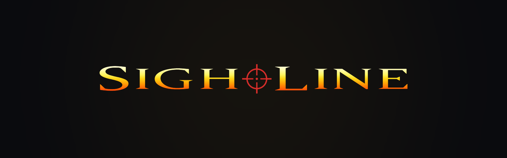
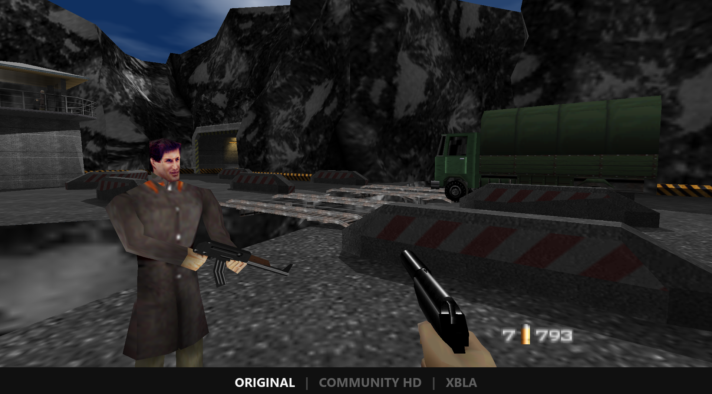

  

# Sightline

Play the GoldenEye 007 single-player campaign on Windows with your own compatible copy of the game. Sightline runs as a Windows game, without an emulator.

**[Download the latest release](https://github.com/mscrnt/Sightline/releases/latest)** · [Getting help](https://github.com/mscrnt/Sightline/wiki) · [What's next](https://github.com/users/mscrnt/projects/9)

Sightline does **not** include the GoldenEye 007 ROM or optional artwork packs. You need your own compatible GoldenEye 007 (USA) `.z64` game file.

## Start playing

The latest release is **v0.4.1** for Windows.

1. Download the Windows ZIP from the [v0.4.1 release page](https://github.com/mscrnt/Sightline/releases/tag/v0.4.1).
2. Extract the whole ZIP to a folder.
3. Double-click **Sightline.cmd**. If your ROM is not beside it, the launcher asks where your ROM is and remembers the location.

You do not need to build the game from source. The current download uses the included launcher; a regular installer and direct game shortcut are [planned for v0.5.0](docs/ROADMAP.md).

If the launcher cannot use your ROM, check the [setup guide](https://github.com/mscrnt/Sightline/wiki) for the supported game version and file format.

## What you can do today

- Play the full single-player campaign with keyboard and mouse or a controller.
- Remap controls and choose widescreen, resolution, window mode, and other display settings.
- Save progress and continue after closing and reopening the game. This was fixed in v0.4.1.
- Choose a visual style and adjust world detail, frame rate, and the optional Optimized Rendering setting.

### Visual styles

| Style | What you need |
| --- | --- |
| **Original** | Only your compatible ROM. |
| **Community HD** | An optional texture pack. Double-click **Get-Textures.cmd** in the current release to fetch and prepare it from its creators. |
| **XBLA** | Your own copy of the Xbox 360 remaster files. [Preparation currently requires extra steps](docs/xbla-setup.md). |

The game skips visual styles whose required artwork is not installed. The planned v0.5.0 installer will guide you through optional artwork setup without scripts or command-line work.

  

## Releases

| Version | What changed |
| --- | --- |
| [v0.4.1](https://github.com/mscrnt/Sightline/releases/tag/v0.4.1) | Saves persist across restarts; unavailable visual styles are skipped; save-file labels are centered. |
| [v0.4.0](https://github.com/mscrnt/Sightline/releases/tag/v0.4.0) | Added an optional Optimized Rendering setting. |
| [v0.3.0](https://github.com/mscrnt/Sightline/releases/tag/v0.3.0) | Added visual styles, enhanced world detail, and frame-rate choices. |
| [v0.2.0](https://github.com/mscrnt/Sightline/releases/tag/v0.2.0) | First downloadable Windows version, with modern controls and display settings. |
| [v0.1.0](https://github.com/mscrnt/Sightline/releases/tag/v0.1.0) | Historical source-only checkpoint; no Windows download. |

An intermittent startup crash inside the NVIDIA OpenGL driver remains under investigation. See the [v0.4.0 notes](https://github.com/mscrnt/Sightline/releases/tag/v0.4.0) for the known limit.

## What's next

**v0.5.0 is planned around easier setup and updates.** The goal is one Windows installer that asks where your ROM already is, helps prepare optional visual styles, lets you choose Original or enhanced settings, and launches the installed game directly. Update checks will be optional, with a way to install future releases from within Sightline.

See the [player roadmap](https://github.com/users/mscrnt/projects/9) for current plans. No release date has been announced.

## Help, credits, and source

- For setup and controls, see the [wiki](https://github.com/mscrnt/Sightline/wiki). To report a problem, open a [GitHub issue](https://github.com/mscrnt/Sightline/issues).
- Sightline is based on the [GoldenEye 007 decompilation project](https://gitlab.com/kholdfuzion/goldeneye_src). The original game is by Rare.
- The optional Community HD artwork is by **intermissionfb**, with font textures by **GhostlyDark**. It is fetched from [its maintainers](https://github.com/GhostlyDark/GoldenEye-007-HD), not included in Sightline.
- Third-party controller models, artwork, and code keep their own licenses. See [licenses and credits](LICENSES/README.md) and [screenshot rights](docs/images/README.md).
- Developers can start with the [source build guide](docs/SetupGuide.md) and [Windows tooling guide](tools/windows/README.md). The player download needs neither.

Sightline is unaffiliated with Rare, Nintendo, MGM, or Danjaq. The project distributes no GoldenEye ROM, XBLA source archive, or game assets derived from either.
